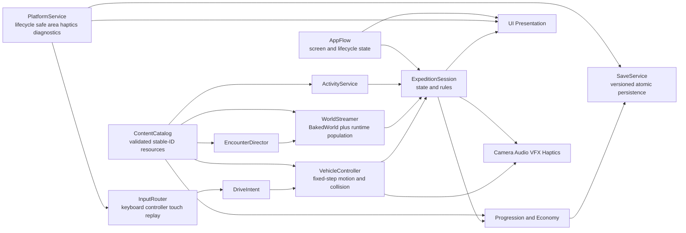

# Keep Driving Technical Architecture

Status: target architecture for 1.0.0
Architecture date: 2026-07-11

## Architecture goals

The 1.0 architecture must:

- Preserve the current prototype's deterministic and bounded proof strengths.
- Make driving, world, content, progression, presentation, save, and platform behavior independently testable.
- Support a hybrid authored/systemic county and catalog-driven vehicles/parts without hardcoded matches.
- Keep one gameplay code path across desktop and iOS; platform variation belongs behind adapters.
- Protect existing and future saves through stable IDs, schemas, migrations, and atomic writes.
- Keep content production and validation cheaper than code changes.
- Expose performance budgets and failure evidence early.
- Stay small enough for the project: explicit modules and typed records, not a framework for hypothetical games.

## Current architecture

The current project is a single generated runtime scene:

```text
main.tscn (GameRoot)
└── GameRoot constructs at runtime
    ├── WorldRuntime -> generated TileMapLayer chunks + WorldEntity nodes
    ├── PlayerVehicle
    ├── Camera2D
    ├── CanvasLayer -> HUD, menus, touch buttons
    └── AudioStreamPlayer placeholders
```

`GameRoot` owns application flow, input, UI construction/layout, camera, contact resolution, resource advancement, save calls, audio requests, effects, and automated proof helpers. `RunProgression` is a useful domain seam, `WorldGenerator` is a useful pure-generation seam, and `WorldRuntime` proves bounded streaming, but public dictionaries and duplicated state couple tests and implementation.

Primary conflicts with the target:

- `scripts/game_root.gd` cannot safely absorb map, contracts, inventory, loadouts, settings, accessibility, lifecycle, localization, and release behavior.
- `scripts/player_vehicle.gd` directly mutates a `Node2D` in variable-delta `_process`; production collision and frame-rate behavior require a new substrate.
- `scripts/world_generator.gd` creates a repetitive four-spoke chunk grammar; the campaign needs an authored macrograph and baked world data.
- `scripts/world_runtime.gd` synchronously generates data and linearly scans/counts entities; production assets and AI need asynchronous loading, spatial queries, lifecycle policies, and real pooling.
- `scripts/run_progression.gd` and `scripts/game_constants.gd` hardcode three upgrades; the target needs stable catalog resources and typed inventory/loadout state.
- `scripts/profile_store.gd` directly overwrites unversioned JSON; release saves require an envelope, validation, backups, migration, and lifecycle rules.
- UI and audio are constructed in the root, preventing reusable scenes, theming, localization, focus navigation, and real asset validation.

## Target module map



Prefer explicit references and narrow signals over a global catch-all event bus. A session owns its runtime modules and disposes them together. Autoloads are reserved for truly application-wide services.

## Module responsibilities

### AppFlow

Owns boot, title, first-launch setup, Garage hub, expedition entry/exit, pause, Results, recovery, and quit transitions.

- Explicit state enum/state objects and allowed transitions.
- Routes screens and session lifetime.
- Coordinates safe save boundaries through `SaveService`.
- Never implements driving, economy, or content rules.
- Handles lifecycle events received from `PlatformService`.

### ExpeditionSession

Authoritative owner for one active expedition:

- Expedition ID/seed, objective, region/time/weather state.
- Fuel, Vehicle Integrity, carried cargo, secured/unsecured rewards.
- Player/chassis/loadout snapshot.
- World mutations and activity/encounter status.
- Success, extraction, failure, abandon, and resume rules.
- Signals/snapshots consumed by UI and feedback.

It replaces mirrored run scalars in `GameRoot`. Presentation receives immutable snapshots or narrow signals; it cannot mutate session dictionaries.

### VehicleController

- Hosted on `CharacterBody2D` or an equivalently robust 2D collision body.
- Runs at fixed 60 Hz in `_physics_process`.
- Consumes normalized `DriveIntent` and `VehicleRuntimeConfig`.
- Owns velocity, acceleration/braking, steering, slip, surface forces, collision movement, contact transitions, recovery, and benchmark telemetry.
- Emits semantic events such as `surface_changed`, `impact`, `drift_started`, and `stuck_state_changed`.
- Does not update profile rewards, HUD text, or audio players.

`VehiclePresentation` separately owns body/wheel animation, damage layers, trail sockets, and visual interpolation. `VehicleCameraRig` owns follow/look-ahead/zoom/shake with accessibility limits.

### InputRouter

Produces platform-independent records:

```gdscript
class_name DriveIntent
var throttle: float       # 0..1
var brake: float          # 0..1
var steer: float          # -1..1
var handbrake: float      # 0..1
var recovery_pressed: bool
```

Sources:

- Keyboard shaping and remapping.
- Controller axes/triggers, dead zones, glyph set, reconnect.
- Touch multi-contact steering/pedals/layout.
- Automated proof/replay source.
- Accessibility assists that transform intent explicitly.

UI navigation uses a separate action layer so menu focus cannot leak into driving. Device changes update prompt glyphs without changing game rules.

### WorldDefinition and content bake

Editor-time authored source:

- `CountyDefinition` and `RegionDefinition` resources.
- `RoadGraph` nodes/edges with route class, surface, width, crossings, and adjacency.
- Landmark, safehouse, objective, event-socket, spawn-zone, weather-zone, and audio-zone scenes/resources.
- Source version and stable content IDs.

A validation/bake step converts authored sources into runtime `BakedWorld` packages:

- Chunk index and bounds.
- Render layers/atlases and collision data.
- Road/terrain sampling data.
- Landmark/objective/socket references.
- Navigation/route graph.
- Streaming dependency and memory metadata.
- Deterministic content hash.

Runtime never attempts to reconstruct authored macro roads from per-chunk noise.

### WorldPopulationGenerator

Evolves the pure parts of the current `WorldGenerator` contract:

- Input: expedition seed, stable chunk ID, region state, objective, recent event history.
- Output: pure deterministic marker/event records for eligible authored sockets/zones.
- Stable IDs for mutation and replay.
- No Godot nodes or scene-tree access in generation.
- Seed fuzz and snapshot/hash proof.

### WorldStreamer

- Loads baked chunk packages around the player using predictive direction/speed prefetch.
- Uses threaded resource loading/pure-data work only; scene attachment remains on the main thread and is amortized.
- Prioritizes terrain/collision, then essential landmarks/objectives, then entities, decoration, and optional effects.
- Maintains bounded active/preload sets and explicit memory/node/draw-call/entity/effect budgets.
- Never shows blank terrain or uses invisible walls. A production-tested Streaming Drag/fallback may limit acceleration only when required terrain is genuinely late.
- Exposes immutable metrics for debug/performance proof.

### SpatialWorld and EntityLifecycle

- Spatial hash/grid for nearby entity/contact/AI queries.
- Pool by entity/effect scene type with hard caps and measured reuse.
- Registration/unregistration owns lifetime; tests do not edit `active_entities` dictionaries.
- Importance/distance budgets reduce optional AI, decoration, and effects before required collision/world state.
- Mutation state lives in the session, not on pooled nodes.

### EncounterDirector

- Selects eligible event templates using region, seed, contract, time, weather, pressure, route state, and repetition history.
- Activates authored sockets with reaction-distance and navigability rules.
- Owns encounter state machines, not low-level entity movement.
- Provides deterministic debug forcing and a recent-template audit.

### ActivityService

- Contract definitions and runtime objectives for salvage/recovery, delivery, restoration, and mastery.
- Validates start requirements, progress, success/failure, reward escrow, extraction, and resume.
- Uses stable activity IDs and versioned state.
- World objects publish semantic interactions; activities do not reach into scene paths.

### ContentCatalog

Application-wide read-only registry loaded at boot:

- `VehicleDefinition`
- `PartDefinition`
- `RegionDefinition`
- `LandmarkDefinition`
- `EncounterDefinition`
- `ContractDefinition`
- `BalanceProfile`
- Cosmetic and audio/visual resource definitions

Catalog validation fails development/CI builds for duplicate/missing IDs, bad references, incompatible slots, invalid costs/ranges, missing localization, missing source/license metadata, or absent proof tags. Runtime content references stable IDs, never resource paths in saves.

### Progression, Garage, Inventory, and Economy

- `ProgressionService` applies restoration/discovery/chassis/blueprint milestones.
- `EconomyService` is the only owner of Scrap sources/sinks and transaction validation.
- `Inventory` owns part instances/copies, intake overflow, secured cargo, and dismantling.
- `LoadoutService` validates chassis slots/capacities and creates immutable `VehicleRuntimeConfig`.
- `GaragePresenter` translates domain facts to comparison UI; it does not calculate affordability or stats.

Transactions return explicit success/failure records and are committed atomically with the save snapshot.

### Presentation

- Player-facing screens are `.tscn` scenes with reusable components, Theme resources, localization keys, focus maps, and responsive layout rules.
- Presenters/view models convert domain snapshots into display state.
- Loading/empty/error/disabled/focus/touch/controller states are part of every component contract.
- Debug UI is a separate development-only CanvasLayer.

### AudioDirector and FeedbackDirector

- Consume semantic vehicle/session/world events.
- Audio owns buses, engine/surface states, impact voice limits, music intensity, ambience, warning priority, and pause/background behavior.
- Feedback owns VFX pooling, camera impulses, UI flashes, and accessibility intensity.
- Platform haptics flow through `PlatformService`; no gameplay module imports an iOS API.
- Tests distinguish request, real resource assignment, routed playback state, captured output/human audible proof, and physical-device haptic proof.

### SettingsService

- Typed defaults, versioned local persistence, validation, platform-specific availability, and live application.
- Separate from progression save so corrupt settings cannot destroy a profile.
- Supports control maps, display, audio, gameplay assists, accessibility, language, and privacy choices.

### PlatformService

Narrow interface with desktop and iOS adapters:

- Platform/capability detection.
- Safe-area and window/aspect facts.
- App foreground/background, interruption, memory warning, and termination notification.
- Haptics.
- Storage path/available-space diagnostics.
- Optional Game Center/cloud hooks, disabled at launch unless explicitly shipped.
- Release build/version and diagnostic information.

Domain/gameplay code must run under a headless/test adapter.

### Telemetry and crash diagnostics

- Define `TelemetrySink` and `CrashDiagnostics` interfaces early; default release implementation can remain privacy-minimal/no-op plus local structured logs and Apple-provided crash diagnostics.
- No advertising identifier, fingerprinting, or cross-app tracking.
- A third-party SDK requires a data inventory, retention/deletion/opt-out policy, privacy manifest/signature validation, App Store label update, offline behavior, symbolication proof, and explicit decision log entry.
- Balance and playtest events should first use local opt-in export so design is not coupled to a backend.

## Save architecture

### Save envelope

```json
{
  "schema_version": 1,
  "build_version": "1.0.0",
  "content_version": 1,
  "profile_id": "local-default",
  "sequence": 123,
  "written_at_utc": "...",
  "checksum": "...",
  "payload": {}
}
```

The payload contains typed/validated sections:

- Profile/restoration/chassis/blueprints/discoveries/records.
- Scrap and inventory with stable catalog IDs.
- Loadout presets.
- Active expedition resume snapshot when eligible.
- Safehouse/world mutations that persist beyond one expedition.
- Tutorial/onboarding state.

Settings live in a separate versioned file.

### Write protocol

1. Build an immutable snapshot on the main thread.
2. Serialize to a temporary file.
3. Flush/close and parse/validate the temporary file.
4. Rotate verified primary to backup A and prior backup A to backup B.
5. Atomically rename the verified temporary file to primary where the platform permits.
6. Reload/validate on development and fault-injection paths.
7. Surface write failure and preserve the last known-good primary/backup.

Never silently replace a corrupt profile with defaults. Copy corrupt material to diagnostics, recover the newest valid sequence, and tell the player what happened.

### Migration

- Migration chain is explicit and fixture-tested: `v0 -> v1 -> ...`.
- Ship fixtures for the current `keep_driving_profile_v0.json`, at least N-2 release schemas, corrupt/truncated/unknown-field cases, max/min values, and removed catalog entries.
- Unknown future fields are retained when safe or ignored without erasing the save.
- Removed catalog content maps to a documented equivalent/refund.
- Migration creates a backup before commit and is idempotent.

### Autosave and resume

- Commit on safehouse/Garage entry, objective/restoration milestone, extraction/results resolution, purchase/fabrication transaction, and clean pause/quit boundary.
- A periodic expedition checkpoint may save at a bounded interval outside collision/streaming spikes.
- Background/interruption requests an immediate bounded snapshot; if time is insufficient, last committed state remains valid.
- Resume restores an eligible expedition consistently or returns to the last safe boundary with an explanation; it never duplicates rewards.
- Manual save slots are not required for 1.0. Reset, backup recovery, and debug import/export are required.

### Cloud readiness

Save identity, monotonic sequence, timestamps, content/schema version, and conflict semantics are defined without implementing cloud synchronization. Optional iCloud support is Valuable if Capacity Allows and requires real conflict-resolution/device testing. Local play never depends on cloud availability.

## World-loading strategy

### Runtime priority

1. Collision and base terrain for the player's current/predicted path.
2. Objective/landmark and safehouse state.
3. Essential encounter entities.
4. Decoration and ambient entities.
5. Optional VFX/detail.

### Provisional budgets

- One main-thread chunk attach per frame maximum until profiling proves a safer budget.
- World work p95 at or below 4 ms on desktop truth/full-stack proofs.
- Zero blank terrain, invisible-wall, or teleport fallback frames.
- Streaming Drag below 1% of frames in a 30-minute high-speed soak.
- Active/preload window and memory are based on device profiling; current 25/49 contract is a starting comparison, not a permanent content mandate.
- Active nodes, pooled entities, effects, draw calls, texture memory, and audio voices have explicit debug counters and caps.

## Content pipeline

### Source-to-runtime flow

```text
Authored Godot scenes/resources + source/license metadata
  -> catalog/world validators
  -> bake atlases, chunk packages, collision, route graph, localization references
  -> deterministic content hash + build manifest
  -> runtime ContentCatalog/BakedWorld
  -> save references by stable ID
```

### Validation requirements

- Stable IDs unique and immutable after release.
- All references resolve.
- Every player-facing string has a localization key.
- Parts meet capability/tradeoff and benchmark metadata rules.
- Contracts have start, success, failure, resume, reward, and extraction definitions.
- Event sockets meet reaction-distance/navigability rules.
- Assets record license/ownership, import settings, atlas group, memory class, and platform compression.
- Content budgets generate a report per region/build.
- The release build contains no debug-only, placeholder, unlicensed, or missing asset.

## Localization

- All strings use Godot translation resources/keys from the first production UI shell.
- No player-facing text assembled from English fragments.
- Number, percentage, unit, time, and plural formatting are localized.
- UI proof runs English, pseudolocalization (+40% expansion), and right-to-left stress layout even if RTL language is not a launch promise.
- Fonts define fallback coverage for supported languages.
- Store metadata languages must match in-game support.

## Testing architecture

### Evidence layers

| Layer | Purpose | Gate |
|---|---|---|
| Unit/domain | Catalog, economy, progression, migration, deterministic generation | Every change |
| Scene integration | Vehicle, UI, session, world, save adapter interactions | Every affected slice |
| Seed/property fuzz | 100+ seeds, 1,000+ world transitions, event eligibility, save ranges | World/content changes |
| Rendered capture | Real scenes, assets, layout/aspect, visual state, audio resource/state | Presentation changes |
| Full-stack performance | Release-like world, vehicle, collision, AI, UI, audio, VFX | Each milestone and content lock |
| Human desktop playtest | Comprehension, handling, enjoyment, pacing, economy | Every player-facing phase |
| Release desktop export | Clean export, install/launch/update, no debug paths | Alpha onward |
| iOS simulator | Layout/basic compatibility only | Mobile phases |
| Physical iOS device | Touch, haptics, audio, frame/memory/thermal/battery/lifecycle/save | Every mobile milestone |
| TestFlight | Install/update, metrics, external devices, review readiness | Beta/RC |

Rename the current automated `manual_smoke_proof` to `loop_simulation_proof`; simulation cannot satisfy a human manual gate.

### Test rules

- Tests use public adapters or dedicated test doubles, not production public dictionaries.
- Avoid manually invoking `_ready()` after adding a node to a live tree.
- Every bug fix gets the smallest regression at the correct layer.
- Performance comparisons store device, build flavor, commit, scene, duration, warm-up, p50/p95/p99, peak memory, and worst-frame evidence.
- Proof scripts return non-zero on failure and emit structured JSON/JUnit-compatible artifacts for CI.

## Debug tooling

Development-only tools:

- Runtime overlay: FPS/frame percentiles, stream work, memory, nodes, draw calls, collision queries, entities/pools, effects, audio voices, seed/chunk/event.
- Seed/region/contract selector and deterministic restart.
- Teleport to safe authored debug anchors.
- Encounter/weather/time forcing.
- Vehicle handling telemetry and standard benchmark track.
- Catalog/part/loadout browser and benchmark matrix.
- Save inspector, migration runner, corruption/interruption fault injector, and profile presets.
- Input visualizer for keyboard/controller/touch multi-contact.
- UI safe-area/aspect/text-scale/pseudolocalization preview.
- Automated screenshot/capture points.

All tools are guarded by build feature flags and absent/inert in release archives.

## Desktop/mobile separation

### Shared

- Domain, world, activities, progression, save schemas, vehicle rules, content catalog, and UI components.
- `DriveIntent` and UI navigation actions.
- Responsive layout rules and content.
- Performance instrumentation and test semantics.

### Platform adapters

- Input source/glyphs and touch layout.
- Safe area, orientation, app lifecycle, haptics, storage diagnostics, controller discovery.
- Export/signing/build packaging.
- Optional Game Center/cloud services.
- Asset compression/quality tier and frame cap.

Do not fork gameplay into `desktop_game.gd` and `mobile_game.gd`. The mobile phase adapts sources, presentation priority, quality, and lifecycle behind stable shared contracts.

## Build pipeline

### Local contract

One documented command should:

1. Verify Godot/Xcode/tool versions where relevant.
2. Import/parse the project cleanly.
3. Validate catalogs, localization, source/licenses, and baked world hashes.
4. Run unit/integration/fuzz suites appropriate to the build.
5. Run or schedule rendered/full-stack proof.
6. Export desktop debug/release or iOS Xcode project using committed presets.
7. Embed semantic version, monotonically increasing build number, commit SHA, content/schema version, and release/debug flags.
8. Produce a build manifest, hashes, symbols, logs, and test evidence.

### CI

- Fast tests and validators on every change.
- Nightly seed fuzz, save faults, full-stack performance, and soak.
- Tagged release pipeline on a controlled macOS runner.
- iOS export/archive/signing secrets remain in protected keychain/CI storage, never repository files.
- Every TestFlight/App Store build maps back to one tag/commit and evidence bundle.

### Release flavors

- Development: debug tools, assertions, local telemetry export, no production signing.
- QA: release-like optimization plus approved diagnostics/test hooks.
- Release: no cheats/debug UI/placeholders; privacy-reviewed SDK set; production identity/signing.

## Performance strategy

### Desktop targets

- Release build: 60 FPS minimum, p95 frame at or below 16.7 ms, p99 at or below 25 ms.
- World work p95 at or below 4 ms.
- No driving hitch above 50 ms in a representative 30-minute run.
- Zero blank terrain or unintentional input stall.
- Memory reaches a plateau within plus/minus 5% after warm-up during a two-hour traversal soak.

### iOS provisional targets

- 60 FPS target on supported A15-class and newer devices.
- Explicitly approved sustained 30 FPS fallback on the minimum device; p95 at or below 33.3 ms.
- Gameplay working set target at or below 350 MB and process peak at or below 500 MB until physical-device evidence tightens the budget.
- Cold launch at or below five seconds; background resume at or below two seconds, target one second.
- Thirty-minute thermal soak without serious sustained throttling or forced quality collapse.
- Battery, storage, and asset/package budgets set from physical baselines before content lock.

### Optimization order

1. Measure release-like content and worst frames.
2. Remove algorithmic/scaling cost and synchronous work.
3. Reduce node/draw/material/physics/audio-voice cost through batching, spatial queries, pooling, and priority.
4. Tune texture/audio compression and quality tiers.
5. Reduce optional density/effects before core readability, collision, objective, or save correctness.

## Migration sequence from the prototype

1. **Characterize:** freeze current loop behavior with public-contract tests and rename simulation evidence honestly.
2. **Create shell:** add ContentCatalog, AppFlow, InputRouter, SettingsService, SaveService interfaces, responsive UI shell, and real audio buses behind existing behavior.
3. **Truth slice:** build fixed-step production handling, one hybrid proof region, representative final presentation/audio, and first-minute flow on desktop.
4. **Migrate progression:** versioned profile/expedition records, v0 migration, catalog-driven chassis/parts, transaction-safe Garage.
5. **Migrate world/runtime:** baked authored macrograph, deterministic population, spatial queries, pools, encounter/activity services.
6. **Scale content:** only after full-stack desktop gates pass.
7. **Prepare mobile:** responsive/input/lifecycle adapters and release pipeline after corresponding desktop systems are stable.

Avoid a flag-day rewrite. Each step keeps a launchable desktop build and removes the superseded path when its replacement passes.

## Technical definition of done

- Module ownership and authority match this document or a recorded replacement decision.
- Catalog, save, input, world, vehicle, UI, audio, and platform contracts have public tests.
- No player-facing system depends on mutable public dictionaries or `GameRoot` internals.
- Clean-clone local and CI verification/export are reproducible.
- Full-stack desktop evidence uses representative production content and meets budgets.
- Save migration, atomicity, recovery, resume, and fault gates pass.
- Mobile entry occurs only after corresponding desktop gates; supported physical devices meet declared budgets.
- Tagged 1.0.0 archive, symbols, manifest, exact App Store build, and evidence are retained.
